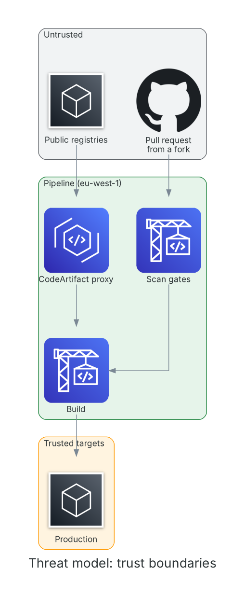

# Threat model

| # | Threat | Control | Residual risk |
|---|---|---|---|
| 1 | Secret committed to source | gitleaks gate blocks the pipeline; CI also runs gitleaks on pull requests | Secret already in history must be rotated |
| 2 | Malicious or vulnerable dependency | CodeArtifact upstream proxy, Trivy filesystem and image scan, SBOM | Zero-day with no advisory |
| 3 | Vulnerable code reaches production | Semgrep SAST (block), ZAP DAST, integration tests, manual approvals | Logic flaws no scanner detects |
| 4 | Pull request from a fork runs privileged builds | Pipeline triggers on the protected branch only | Branch protection must be configured in GitHub |
| 5 | Stolen CodeBuild credentials | Short-lived role credentials, scoped policy, deploy roles trusted only by this role | Compromised build still reaches ECR and the deploy roles |
| 6 | Image overwritten after approval | Images are tagged with the commit SHA and the deploy stage uses that exact image definition | Tag immutability is a Landing Zone repository setting |
| 7 | Tampered artifacts | Versioned, TLS-only bucket; only the two pipeline roles can write | AWS-managed key means no separate key policy boundary |
| 8 | Alert suppression | Alarm on failed pipelines, EventBridge rules, SNS email subscription | Email delivery is best effort |
| 9 | Unreviewed deploy to prod | `require_prod_approval` defaults to true | Approvers can approve without review |
| 10 | Region outage in eu-west-1 | Workloads keep running; releases pause (docs/dr-and-resilience.md) | Accepted |
